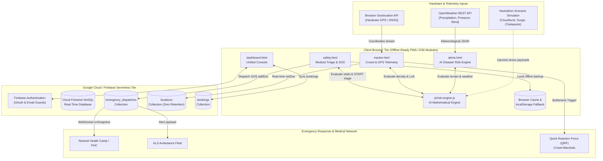
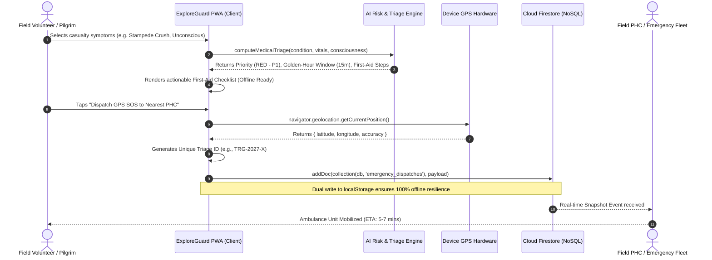

# ExploreGuard — Technical Architecture Document (ARCHITECTURE.md)

**Hack for Social Cause (VBYLD 2027)**  
**Theme:** *Disaster Mitigation, Kumbh Mela & Health Service Delivery*  
**Platform Version:** `2.0.0 (Hackathon Release)`  
**Repository:** [exploreguard](https://github.com/YOUR_USERNAME/exploreguard)  
**License:** MIT License  

---

## 1. Executive Summary & VBYLD 2027 Alignment

ExploreGuard 2.0 is an intelligent, serverless, edge-resilient humanitarian safety platform built specifically for high-risk transit corridors and extreme mass-gatherings. Developed for the **VBYLD 2027 Hack for Social Cause**, the system unifies three mission-critical pillars:

1. **Disaster Mitigation:** Real-time AI Multi-Hazard Risk Prediction analyzing meteorological telemetry (rainfall, humidity, wind velocity, barometric depression) combined with geomorphological terrain vulnerability factors along critical mountain corridors (e.g., Manipur NH-2 and NH-37) and river flood plains.
2. **Kumbh Mela & Mass-Gathering Crowd Safety:** Continuous sector-by-sector crowd density telemetry ($p/m^2$), Fruin Level of Service (LoS) analysis, automated bottleneck triggers, and dynamic decongestion rerouting protocols.
3. **Health Service Delivery & Golden-Hour Medical Triage:** Clinical START and Manchester triage automation for stampede crush trauma, heatstroke, landslide impact injuries, and cardiopulmonary distress, with one-touch GPS-tagged SOS dispatching to nearest Primary Health Centres (PHCs) and Cloud Firestore synchronization.

### UN Sustainable Development Goals (SDG) Alignment:
* **SDG 3: Good Health and Well-Being** (Target 3.6 & 3.d): Halving road/landslide transit casualties and strengthening early warning systems for national and global health risks.
* **SDG 11: Sustainable Cities and Human Settlements** (Target 11.5): Significantly reducing disaster casualties and direct economic losses caused by water-related disasters and landslides.
* **SDG 13: Climate Action** (Target 13.1): Strengthening resilience and adaptive capacity to climate-induced cloudbursts and flash-flood events.

---

## 2. System Architecture

ExploreGuard is architected as a **client-first, zero-overhead serverless system**. It combines hardware browser sensors (HTML5 Geolocation API), remote meteorological REST endpoints (OpenWeather API), client-side mathematical risk engines, and Google Cloud Firestore real-time NoSQL streaming.



---

## 3. End-to-End Data Flow

The following sequence diagram details the operational lifecycle during an active casualty triage and crowd emergency event:



---

## 4. Algorithmic Formulations & Mathematical Models

### 4.1. AI Multi-Hazard & Landslide Risk Formulation
The AI Multi-Hazard Engine models slope failure probability by cross-referencing live meteorological telemetry with static geological fragility indices:

1. **Precipitation Intensity Index ($P_{rain}$):**
   $$P_{rain} = \begin{cases} 
   0.05 + \left(\frac{R}{15}\right) \times 0.35 & \text{if } R \le 15\text{ mm/h} \\
   0.40 + \left(\frac{R - 15}{25}\right) \times 0.35 & \text{if } 15 < R \le 40\text{ mm/h} \\
   \min\left(1.0, 0.75 + \left(\frac{R - 40}{40}\right) \times 0.25\right) & \text{if } R > 40\text{ mm/h}
   \end{cases}$$
   *(where $R$ is rainfall in mm/h).*

2. **Atmospheric Depression Index ($B$):**
   $$B = \min\left(1.0, \max\left(0, \frac{1013 - P_{atm}}{20}\right)\right)$$
   *(where $P_{atm}$ is barometric pressure in hPa; drops below 1010 hPa indicate monsoon cyclonic depressions).*

3. **Terrain Slope & Fragility Coefficient ($T_{sf}$):**
   $$T_{sf} = (W_{slope} \times 0.55) + (W_{fragility} \times 0.45)$$

4. **Landslide Failure Probability ($P_{landslide}$):**
   $$P_{landslide} = \min\left(99, \max\left(5, \text{round}\left((0.42 P_{rain} + 0.18 H + 0.30 T_{sf} + 0.06 B + 0.04 W_{wind}) \times W_{hist} \times 105\right)\right)\right)$$
   *(where $H$ is normalized relative humidity and $W_{hist}$ is historical landslide recurrence).*

5. **Flash-Flood Inundation Probability ($P_{flood}$):**
   $$P_{flood} = \min\left(99, \max\left(4, \text{round}\left((0.52 P_{rain} + 0.28 W_{flood\_plain} + 0.12 H + 0.08 B) \times 100\right)\right)\right)$$

6. **Composite Multi-Hazard Score ($Score$):**
   $$Score = \text{round}\left(0.75 \times \max(P_{landslide}, P_{flood}) + 0.25 \times \min(P_{landslide}, P_{flood})\right)$$

* **Risk Tiers:**
  * **Critical:** $Score \ge 70$ (DaisyUI `badge-error`, immediate transit halt & evacuation order).
  * **Moderate:** $40 \le Score < 70$ (DaisyUI `badge-warning`, cautionary speed limit & inter-vehicle buffer).
  * **Low:** $Score < 40$ (DaisyUI `badge-success`, standard operational conditions).

---

### 4.2. Kumbh Mela Crowd Density & Pedestrian Level of Service (LoS)
Crowd dynamics adhere to **Fruin's Pedestrian Planning Principles**:

$$\text{Density } (D) = \frac{\text{Headcount } (N)}{\text{Effective Sector Area } (A\text{ in m}^2)}$$

$$\text{Flow Ratio } (F_r) = \frac{\text{Inflow Rate } (Q_{in})}{\max(1, \text{Outflow Rate } (Q_{out}))}$$

* **Level of Service Categorization:**
  * **LoS A–C ($D < 2.0\text{ p/m}^2$):** Fluid, unconstrained transit. Stampede Risk = **Safe**.
  * **LoS D–E ($2.0 \le D < 4.0\text{ p/m}^2$):** Constrained, slow shuffling. Stampede Risk = **Moderate**.
  * **LoS F ($D \ge 4.0\text{ p/m}^2$ OR $D \ge 3.2\text{ p/m}^2 \land F_r > 1.8$):** Shockwave compression hazard. Stampede Risk = **Critical**.
  * **Automated Bottleneck Alert:** Instantly triggered when $D \ge 4.0$ or $F_r > 1.4$, providing safe egress diversion routing to avoid counter-flow collisions.

---

### 4.3. Clinical Emergency Medical Triage (START / Manchester System)
Triage categorizes casualties based on physiological golden-hour survival parameters:

| Priority Level | Color Tag | Criteria | Golden-Hour Window | Target Medical Facility |
| :--- | :--- | :--- | :--- | :--- |
| **P1 - Immediate** | 🔴 RED | Unconscious, respiratory distress, active arterial hemorrhage, severe crush asphyxia | $< 15 - 30$ minutes | Tertiary Trauma Bay / Resuscitation ICU |
| **P2 - Urgent** | 🟡 YELLOW | Severe dehydration, core temp $>40^\circ\text{C}$, closed fractures, disorientation | $< 45 - 60$ minutes | Mobile Field Stabilization Camp |
| **P3 - Minor** | 🟢 GREEN | Walking wounded, superficial abrasions, joint sprains | $< 120$ minutes | Outpatient First-Aid Post |

---

## 5. Cloud Firestore Database Schema

### 5.1. `emergency_dispatches` & `triages` Collection
```json
{
  "triageId": "TRG-M8X2K9-402",
  "patientUid": "c92Fk18Xyz",
  "patientName": "Sunil Kumar",
  "priority": "RED",
  "priorityLabel": "Red - Immediate",
  "conditionTitle": "Stampede Trauma / Crush Injury",
  "symptomsDescription": "Crush asphyxia, breathing difficulty near bridge exit",
  "clinicalReason": "Life-threatening physiological crisis detected: Compromised airway",
  "vitals": {
    "consciousness": "unconscious",
    "breathingDifficulty": true,
    "severeBleeding": false,
    "pulseRate": 135
  },
  "recommendedFacility": "Kumbh Sector 4 Field Hospital & Resuscitation Center",
  "coordinates": {
    "latitude": 25.43120,
    "longitude": 81.88450,
    "accuracy": 12,
    "fallback": false
  },
  "timestamp": "2026-10-26T22:30:00.000Z",
  "status": "ACTIVE_DISPATCH_TO_FIELD_UNIT",
  "etaMinutes": 5
}
```

### 5.2. `locations` Collection (Zero-Background-Logging Stream)
```json
{
  "uid": "c92Fk18Xyz",
  "name": "Sunil Kumar",
  "latitude": 24.81702,
  "longitude": 93.93684,
  "accuracy": 8,
  "updatedAt": "2026-10-26T22:31:15.000Z",
  "sharing": true
}
```
*Note: When user turns the tracking switch OFF, a Firestore `deleteDoc` instruction immediately purges this record from the database.*

---

## 6. Offline Resilience & Edge Availability

In remote mountain terrains of Manipur and high-density Kumbh Mela sectors, cellular bandwidth often suffers from severe attenuation or localized network collapse. ExploreGuard incorporates:

1. **Client-Side Mathematical Execution:** All hazard risk scoring and triage logic are computed locally in ES6 without server dependencies.
2. **Offline First-Aid Protocols:** Emergency clinical protocols (CPR, tourniquet application, heatstroke misting, cervical spine immobilization) are bundled inside client memory and display instantly without network round-trips.
3. **Local Storage SOS Backup:** Every SOS dispatch write is dual-cached in `localStorage('last_emergency_dispatch')` so no payload is dropped if the device temporarily disconnects.
4. **Direct Telephony Fallback:** One-tap native dialers (`tel:112`, `tel:108`, `tel:101`) bridge directly to the Public Switched Telephone Network (PSTN) bypassing IP network congestion.

---

## 7. Verification & Automated Test Suite

The platform includes an automated validation suite in `tests/test_risk_engine.js` covering 28 test assertions:

```bash
# Execute test suite
npm test
# or
node tests/test_risk_engine.js
```

**Verification Results:**
* `28 Passed, 0 Failed (100% Pass Rate)`
* Tests verify extreme cloudburst risks, dry conditions, flood plain prioritization, crowd LoS thresholds, bottleneck alerts, and clinical triage priority escalations.
