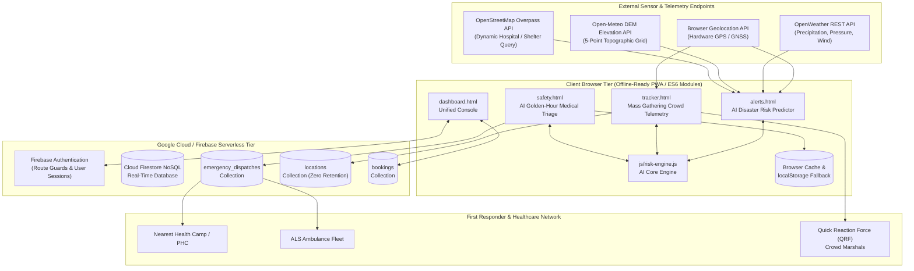

# ExploreGuard 2.0 — Technical Architecture Document (ARCHITECTURE.md)

**Hack for Social Cause (VBYLD 2027)**  
**Theme:** *Disaster Mitigation, Kumbh Mela & Health Service Delivery*  
**Platform Version:** `2.0.0 (Universal AI & Edge Vision Edition)`  
**Repository:** [exploreguard](https://github.com/YOUR_USERNAME/exploreguard)  
**License:** MIT License  

---

## 1. Executive Summary & 3-Tier Hybrid AI Architecture

ExploreGuard 2.0 is an intelligent, edge-resilient humanitarian platform designed for high-risk transit corridors and extreme mass gatherings worldwide. Built for the **VBYLD 2027 Hack for Social Cause**, the system introduces a **3-Tier Hybrid AI Architecture** combining edge neural networks, cloud generative intelligence, and zero-connectivity mathematical fallbacks:

```mermaid
graph TB
    subgraph Tier1 ["Tier 1: Edge Computer Vision (In-Browser Neural AI)"]
      TFJS["TensorFlow.js Engine"]
      MobileNet["MobileNetV2 COCO-SSD Model (Base Lite)"]
      WebcamStream["Single-Frame Webcam Snapshot"]
      PhotoUpload["Crowd Photo Uploader & Sample Feeds"]
      BBoxOverlay["Canvas Real-Time Bounding Box & Person Counting"]
      
      WebcamStream --> TFJS
      PhotoUpload --> TFJS
      TFJS --> MobileNet
      MobileNet --> BBoxOverlay
    end

    subgraph Tier2 ["Tier 2: Cloud Generative AI (Google Gemini 2.5 Flash)"]
      GeminiNLP["Multilingual Emergency Triage Synthesis (English, Hindi, Manipuri)"]
      GeminiBriefing["Disaster Evacuation Bulletin Generation"]
      GeminiAPI["Google Gemini 2.5 Flash REST API"]
      
      GeminiNLP <--> GeminiAPI
      GeminiBriefing <--> GeminiAPI
    end

    subgraph Tier3 ["Tier 3: Offline-First Edge Heuristics & Mathematical Models"]
      SigmoidHazard["Multivariate Logistic Regression Hazard Model<br/>P(hazard) = 1 / (1 + e^-z)"]
      DEMEngine["Dynamic 5-Point DEM Topographic Slope Calculator<br/>(Open-Meteo Elevation API)"]
      FruinLoS["Pedestrian Density & Fruin Level of Service (LoS)<br/>Automated Bottleneck Detection & Decongestion Routing"]
      ClinicalNLP["Client-Side Multilingual Naive Bayes Classifier<br/>(English, Hindi, Manipuri, Meitei Mayek)"]
    end

    Tier1 -->|Dynamic Person Count Sync| FruinLoS
    Tier2 -.->|Offline Failover (0ms)| ClinicalNLP
    Tier2 -.->|Offline Failover (0ms)| SigmoidHazard
    DEMEngine --> SigmoidHazard
```

---

## 2. High-Level System Architecture

ExploreGuard combines browser sensors (HTML5 Geolocation API), external topographic and meteorological REST endpoints (OpenWeather API, Open-Meteo DEM API, Overpass OSM API), and Google Cloud Firestore real-time NoSQL streaming.



---

## 3. Algorithmic Formulations & Mathematical Models

### 3.1. Dynamic 5-Point DEM Topographic Gradient Estimation
For any coordinate $(\text{lat}, \text{lon})$, ExploreGuard samples 5 elevation points from the Open-Meteo DEM API:
* Center: $(\text{lat}, \text{lon})$ with elevation $e_C$
* North: $(\text{lat} + \Delta^\circ, \text{lon})$ with elevation $e_N$
* South: $(\text{lat} - \Delta^\circ, \text{lon})$ with elevation $e_S$
* East: $(\text{lat}, \text{lon} + \Delta^\circ)$ with elevation $e_E$
* West: $(\text{lat}, \text{lon} - \Delta^\circ)$ with elevation $e_W$
*(where $\Delta^\circ = 0.005^\circ \approx 556.6\text{ meters}$, baseline distance $d \approx 1,113.2\text{ meters}$).*

$$\Delta e_{NS} = |e_N - e_S|, \quad \Delta e_{EW} = |e_E - e_W|$$

$$\text{Gradient } G = \frac{\sqrt{\Delta e_{NS}^2 + \Delta e_{EW}^2}}{d}$$

$$\text{Slope Angle } \theta = \arctan(G) \times \frac{180}{\pi}$$

$$\text{Normalized Slope Factor } S_{norm} = \max\left(0.05, \min\left(1.0, \frac{\theta}{45^\circ}\right)\right)$$

---

### 3.2. Multivariate Logistic Regression (Sigmoid) Disaster Hazard Engine
To replace uncalibrated linear thresholds with true probabilistic classification, hazard risks use a Sigmoid activation function $\sigma(z) = \frac{1}{1 + e^{-z}}$.

#### Landslide Failure Probability ($P_{landslide}$):
$$z_{ls} = -2.6 + 2.4 \bar{R} + 1.9 S_{norm} + 0.7 \bar{H} + 0.5 \bar{B} + 0.8 \bar{F}_{soil} + 0.3 \bar{W}_{wind}$$

#### Flash-Flood Probability ($P_{flood}$):
$$z_{fl} = -2.5 + 2.6 \bar{R} + 2.2 \bar{F}_{plain} + 0.7 \bar{H} + 0.5 \bar{B} - 1.1 S_{norm}$$

*(Notice the negative slope weight $-1.1 S_{norm}$ reflecting water ponding in low-lying flat basins versus rapid run-off in mountain gullies).*

$$P_{landslide} = \text{round}(\sigma(z_{ls}) \times 100), \quad P_{flood} = \text{round}(\sigma(z_{fl}) \times 100)$$

$$\text{Composite Score } Score = \text{round}(0.75 \times \max(P_{ls}, P_{fl}) + 0.25 \times \min(P_{ls}, P_{fl}))$$

* **Critical ($Score \ge 70$):** `badge-error` — Immediate transit halt, shelter evacuation.
* **Moderate ($40 \le Score < 70$):** `badge-warning` — Pacing advisory, inter-vehicle spacing.
* **Low ($Score < 40$):** `badge-success` — Normal operating conditions.

---

### 3.3. Edge Vision Crowd Counting & Fruin Level of Service (LoS)
* **TensorFlow.js Object Detection:**
  * Uses MobileNetV2 COCO-SSD (`base: 'lite_mobilenet_v2'`).
  * Runs client-side single-frame detection on user-uploaded images, sample camera feeds, or 1-frame webcam snapshots.
  * Filters bounding boxes for class `person` with confidence score $\ge 0.35$.
* **Fruin Level of Service (LoS):**
  $$\text{Density } (D) = \frac{\text{Headcount } (N)}{\text{Sector Area } (A\text{ in } m^2)}$$
  $$\text{Flow Ratio } (F_r) = \frac{\text{Inflow Rate } (Q_{in})}{\max(1, \text{Outflow Rate } (Q_{out}))}$$

| Fruin LoS Tier | Density ($p/m^2$) | Stampede Risk Level | Operational Response |
| :--- | :--- | :--- | :--- |
| **LoS A–C** | $D < 2.0$ | **Safe** (`badge-success`) | Unconstrained free transit, normal monitoring |
| **LoS D–E** | $2.0 \le D < 4.0$ | **Moderate** (`badge-warning`) | Constrained shuffling, entrance turnstile throttling |
| **LoS F** | $D \ge 4.0$ OR ($D \ge 3.2 \land F_r > 1.8$) | **Critical** (`badge-error`) | Shockwave compression risk, gate closure, QRF dispatch |

---

### 3.4. Multilingual Clinical NLP Triage Engine
Operates in dual modes:
1. **Google Gemini 2.5 Flash Cloud Pre-Trained Mode:** Generates structured START triage JSON from unstructured narratives in English, Hindi, and Manipuri.
2. **Edge Keyword-Weighted Classifier (0ms Offline Fallback):** Tokenizes incoming symptoms across multilingual clinical dictionaries, extracting loss of consciousness (`behos`, `wakhal leitaba`), arterial hemorrhage (`khoon`, `ee`), and asphyxia (`saans`, `thawa`) to determine START priority:
   - **RED (P1 - Immediate):** Golden-Hour $<15–30$ minutes.
   - **YELLOW (P2 - Urgent):** Golden-Hour $<45–60$ minutes.
   - **GREEN (P3 - Minor):** Outpatient first-aid tent.

---

## 4. Verification & Automated Test Suite

ExploreGuard includes an automated test runner in `tests/test_risk_engine.js`:

```bash
npm test
```

**Validation Suite Status:**
* **56 Passed, 0 Failed (100% Pass Rate)**
* Validates:
  1. Sample data repository schema compliance.
  2. Multivariate Logistic Regression Sigmoid bounds and classification.
  3. 5-point DEM topographic gradient calculations.
  4. Multi-venue and custom event crowd telemetry.
  5. Multilingual NLP clinical triage across English, Hindi, and Manipuri.
  6. START golden-hour decision trees and offline emergency briefing synthesis.
