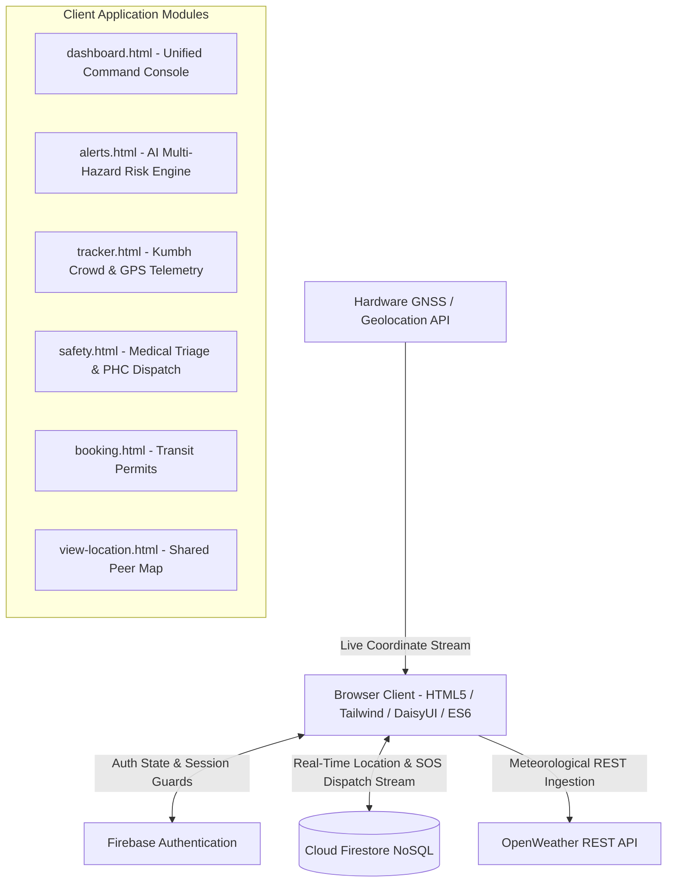

# ExploreGuard 2.0 — Disaster Mitigation, Kumbh Mela Crowd Telemetry & Golden-Hour Health Delivery

[](LICENSE)
[](https://github.com/YOUR_USERNAME/exploreguard)
[](ARCHITECTURE.md)
[](tests/test_risk_engine.js)

**ExploreGuard 2.0** is an intelligent, edge-resilient, serverless humanitarian companion engineered for the **Hack for Social Cause (VBYLD 2027)** under the theme **"Disaster Mitigation, Kumbh Mela & Health Service Delivery"**.

By combining live meteorological telemetry (OpenWeather API), geomorphological terrain susceptibility models (Manipur NH-2 / NH-37 mountain corridors & flood plains), real-time mass-gathering crowd density dynamics, and clinical START/Manchester emergency medical triage, ExploreGuard bridges the critical gap between environmental hazard awareness, mass crowd safety, and golden-hour emergency response.

---

## 🎯 VBYLD 2027 Theme & UN SDG Alignment

| Hackathon Pillar | Solution Delivered | UN SDG Alignment |
| :--- | :--- | :--- |
| **Disaster Mitigation** | Real-time AI Multi-Hazard & Landslide Risk Engine (`alerts.html` & `dashboard.html`) ingesting precipitation, humidity, barometric pressure, and terrain vulnerability weights. | **SDG 13: Climate Action** (13.1)<br/>**SDG 11: Sustainable Cities** (11.5) |
| **Kumbh Mela Crowd Safety** | Mass-gathering pedestrian density telemetry ($p/m^2$), Fruin LoS categorization, automated bottleneck detection, and safe decongestion rerouting (`tracker.html`). | **SDG 11: Sustainable Cities & Communities** (11.7) |
| **Health Service Delivery** | AI Golden-Hour Medical Triage (Red/Yellow/Green), offline-ready emergency first-aid protocols, and one-tap GPS SOS dispatching to nearest PHCs via Cloud Firestore (`safety.html`). | **SDG 3: Good Health & Well-being** (3.6 & 3.d) |

---

## 🚀 Key Innovations & Upgrades

### 1. AI Multi-Hazard & Landslide Risk Engine (`alerts.html` & `dashboard.html`)
* **Real-time Telemetry Ingestion:** Reads live OpenWeather parameters: rainfall intensity (mm/h), atmospheric pressure (hPa), humidity (%), and wind speed (km/h).
* **Regional Terrain Vulnerability Weights:** Models high-risk corridors including **Manipur NH-37 (Imphal-Jiribam Landslide Corridor)**, **NH-2 (Imphal-Kohima Montane Pass)**, **Imphal Valley Flood Plains (Thoubal/Bishnupur)**, and **Kumbh Mela Sangam Riverbank Lowlands**.
* **Mathematical Risk Scoring:** Evaluates real-time Landslide Probability (0-100%), Flash-Flood Probability (0-100%), and Composite Risk with DaisyUI badges (`badge-success`, `badge-warning`, `badge-error`).
* **Contextual Evacuation Guidance:** Outputs explicit disaster mitigation recommendations, designated safe evacuation shelters, and high-risk chokepoint warnings.
* **Interactive Hackathon Simulator:** Built-in scenario presets (*Monsoon Cloudburst 68.5 mm/h*, *Cyclonic Depression*, *Safe Transit*) plus an interactive rainfall rate slider (0-100 mm/h) for live judge demonstrations.

### 2. Kumbh Mela & Mass-Gathering Crowd Telemetry (`tracker.html`)
* **Dual-Mode Telemetry Switcher:** Seamlessly toggles between personal **GPS Journey Tracker** and the **Kumbh Mela Crowd Safety Mode**.
* **Sector-by-Sector Monitoring:** Real-time metrics across 4 key sectors:
  * **Sector A:** Sangam Holy Bathing Ghat
  * **Sector B:** Transit Hub & Pontoon Bridges
  * **Relief Camp Zone:** Food & Shelter Camp
  * **Medical Corridor:** Emergency Field PHC & Ambulance Artery
* **Fruin Pedestrian Level of Service (LoS):** Computes crowd density (persons/$m^2$), classifying flows into Safe ($<2.0\text{ p/m}^2$), Moderate ($2.0-4.0\text{ p/m}^2$), and Critical Stampede Risk ($>4.0\text{ p/m}^2$).
* **Automated Bottleneck Detection & Decongestion Routing:** When inflow exceeds outflow or density spikes, automated alerts trigger dynamic pedestrian diversion routing to clear chokepoints.

### 3. AI Golden-Hour Medical Triage & Health Delivery (`safety.html`)
* **START & Manchester Clinical Triage:** Evaluates casualties across high-risk presentations: *Stampede Trauma / Crush Asphyxia*, *Severe Dehydration / Heatstroke*, *Landslide / Rockfall Trauma*, and *Cardiac / Acute Respiratory Distress*.
* **Rapid Priority Stratification:** Instant classification into **RED (P1 - Immediate, $<20$ min Golden Hour)**, **YELLOW (P2 - Urgent)**, or **GREEN (P3 - Minor Walking Wounded)**.
* **Offline-Ready First-Aid Protocols:** Detailed, pre-cached life-saving instructions (CPR, recovery position, direct pressure/tourniquets, rapid cooling, cervical immobilization) accessible with zero internet.
* **One-Tap GPS SOS Dispatch:** Queries device GPS hardware, packages the patient's vitals, priority, and symptoms, and writes the emergency payload directly to **Cloud Firestore** (`triages` & `emergency_dispatches` collections) while dual-caching to `localStorage`.

### 4. Privacy-First Consent Tracking (`tracker.html` & `view-location.html`)
* **Zero Background Logging:** GPS coordinate streaming activates strictly when the user toggles location sharing ON.
* **Instant Cloud Purge:** Turning the toggle OFF immediately triggers a Firestore `deleteDoc` operation, erasing all location records from the cloud.

---

## 🏛️ System Architecture

For in-depth mathematical formulations, data schemas, and Mermaid.js diagrams, review **[ARCHITECTURE.md](ARCHITECTURE.md)**.



---

## 📂 Repository Structure

```
exploreguard/
│
├── 📂 css/                           # Modular stylesheets & design systems
│   ├── global.css                   # Global variables, sticky navigation, typography
│   ├── alerts.css                   # Risk engine cards & weather meters
│   ├── dashboard.css                # Dashboard panels & boarding pass metrics
│   ├── tracker.css                  # Crowd dials, LoS gauges & map frames
│   ├── safety.css                   # Triage widgets, SOS pulses & dial cards
│   ├── booking.css                  # Travel permit wizards
│   └── index.css                    # Hero visual grids & feature highlights
│
├── 📂 js/                            # ES6 modular controllers
│   ├── risk-engine.js               # AI Multi-Hazard, Crowd Density & Triage Core Math
│   ├── alerts.js                    # Weather telemetry & risk engine UI controller
│   ├── dashboard.js                 # Dashboard summary & Firestore booking queries
│   ├── tracker.js                   # GPS geolocation & Kumbh crowd telemetry controller
│   ├── safety.js                    # Medical triage assessor & Firestore SOS dispatcher
│   ├── booking.js                   # Transit booking Firestore transactions
│   ├── login.js                     # Firebase authentication & redirect guards
│   └── view-location.js             # Recipient live map WebSocket onSnapshot listener
│
├── 📂 sample_data/                   # Rich mock telemetry & triage test fixtures
│   └── mock_hazard_crowd_health_data.json
│
├── 📂 tests/                         # Automated validation test suites
│   └── test_risk_engine.js          # 28 automated unit & integration assertions
│
├── 📄 config.example.js              # Template configuration file
├── 📄 config.js                      # Local API configuration (Git-ignored)
├── 📄 firebase-config.js             # Firebase Authentication & Firestore entry point
├── 📄 ARCHITECTURE.md                # Comprehensive Technical Design Document
├── 📄 LICENSE                        # Standard MIT License
├── 📄 package.json                   # Project metadata & test execution scripts
└── 📄 README.md                       # Project documentation
```

---

## ⚙️ Local Setup & Execution Guide

Because ExploreGuard is built on a serverless client architecture, it runs without heavy server-side dependencies.

### 1. Clone the Repository
```bash
git clone https://github.com/YOUR_USERNAME/exploreguard.git
cd exploreguard
```

### 2. Configure Environment Keys
Create a local `config.js` file from the provided template:
```bash
cp config.example.js config.js
```
Open `config.js` and add your OpenWeather API key:
```javascript
window.CONFIG = {
  OPENWEATHER_API_KEY: 'YOUR_OPENWEATHER_API_KEY_HERE'
};
```
*(Note: If you do not have an API key, ExploreGuard includes an interactive in-browser key setup prompt as well as offline regional telemetry fallbacks and simulated hackathon scenarios).*

### 3. Run Automated Validation Tests
Ensure Node.js (v18+) is installed, then run the test suite:
```bash
npm test
# or
node tests/test_risk_engine.js
```
**Expected Output:** `28 Passed, 0 Failed (100% Pass Rate)`.

### 4. Launch Local Development Server
Serve the repository using any local HTTP server:
* **Using Node's npx:**
  ```bash
  npx serve .
  ```
* **Using Python:**
  ```bash
  python -m http.server 8000
  ```
* **Using VS Code:** Right-click `index.html` and select **"Open with Live Server"**.

Visit `http://localhost:8000` in your browser.

---

## 🧪 Automated Test Suite Validation

The test suite in `tests/test_risk_engine.js` validates all core mathematical and clinical algorithms:
1. **Sample Data Integrity:** Validates JSON schema adherence across weather scenarios, Kumbh crowd sectors, and emergency triage records.
2. **AI Disaster Risk Calculations:** Asserts that torrential cloudbursts ($>60\text{ mm/h}$) on high-vulnerability corridors (NH-37) produce `Critical` landslide probability ($\ge 70\%$) with evacuation instructions, while flat river basins (Thoubal) prioritize flash-flood probability.
3. **Kumbh Mela Crowd Telemetry:** Asserts that safe headcounts evaluate to Fruin LoS A–C, while surges ($>4.0\text{ p/m}^2$) activate the automated bottleneck alert and trigger decongestion rerouting.
4. **Clinical Triage Logic:** Asserts that unconscious or actively hemorrhaging casualties escalate to `RED (P1 - Immediate)` with $<20$ min golden-hour targets, while walking wounded evaluate to `GREEN (P3)`.

---

## 📜 License

ExploreGuard is released under the **MIT License**. See [LICENSE](LICENSE) for full details.
