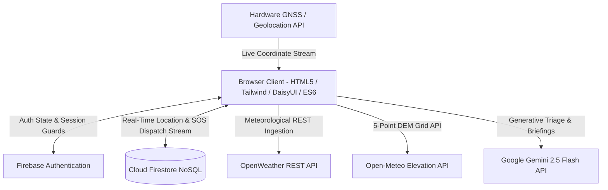

> **Prototype status (30 October 2026):** Experimental scoring and person detection, not a validated emergency service. The fixes on `fix/honest-prototype-results` remove fabricated camera detections and false dispatch confirmations. See [FIXES.md](FIXES.md) for changes, test scope, setup and remaining work. Earlier feature descriptions below describe aspirations where they conflict with this status. No ambulance or PHC integration is active.

# ExploreGuard 2.0 — AI Disaster Mitigation, Mass Gathering Crowd Telemetry & Golden-Hour Health Delivery

[](LICENSE)
[](https://github.com/YOUR_USERNAME/exploreguard)
[](ARCHITECTURE.md)
[](tests/test_risk_engine.js)
[](tracker.html)
[](safety.html)

**ExploreGuard 2.0** is an intelligent, edge-resilient humanitarian companion engineered for the **Hack for Social Cause (VBYLD 2027)** under the theme **"Disaster Mitigation, Kumbh Mela & Health Service Delivery"**.

It features a **3-Tier Hybrid AI Architecture** combining in-browser Computer Vision (TensorFlow.js MobileNetV2 Lite), cloud pre-trained Generative AI (Google Gemini 2.5 Flash), and offline-first mathematical models (Multivariate Logistic Sigmoid Regression, Open-Meteo 5-point DEM topographic slope estimation, Fruin Level of Service crowd dynamics, and START/Manchester clinical decision trees).

---

## 🎯 VBYLD 2027 Theme & UN SDG Alignment

| Hackathon Pillar | Solution Delivered | UN SDG Alignment |
| :--- | :--- | :--- |
| **Disaster Mitigation** | Universal AI Multi-Hazard Risk Predictor (`alerts.html` & `dashboard.html`) ingesting OpenWeather telemetry, Open-Meteo Shuttle Radar DEM elevation gradients, and Overpass OSM emergency shelters for any coordinate worldwide (plus Manipur benchmark corridors NH-2 & NH-37). | **SDG 13: Climate Action** (13.1)<br/>**SDG 11: Sustainable Cities** (11.5) |
| **Mass-Gathering Crowd Safety** | Edge Computer Vision Crowd Counter (TensorFlow.js COCO-SSD), multi-venue switcher (Prayagraj Kumbh Mela, Imphal Lai Haraoba & Custom Live GPS venue), Fruin LoS density ($p/m^2$), and automated bottleneck decongestion routing (`tracker.html`). | **SDG 11: Sustainable Cities & Communities** (11.7) |
| **Health Service Delivery** | Multilingual Generative Medical Triage (Google Gemini 2.5 Flash + 0ms client-side Naive Bayes NLP fallback in English, Hindi, and Manipuri), offline first-aid protocols, and one-tap GPS SOS dispatching to nearest PHCs via Cloud Firestore (`safety.html`). | **SDG 3: Good Health & Well-being** (3.6 & 3.d) |

---

## 🧠 3-Tier Hybrid AI Architecture

1. **Tier 1 — Edge Computer Vision (Zero Local Training):**
   * Pre-trained **TensorFlow.js + MobileNetV2 COCO-SSD** runs directly inside the client browser.
   * Lazy-loaded strictly upon user interaction (conserves laptop CPU/GPU).
   * Features single-frame webcam capture, custom photo uploads, and sample camera feeds with real-time bounding boxes and confidence scores.
   * Directly syncs detected headcount into the Fruin Level of Service ($p/m^2$) crowd calculator.

2. **Tier 2 — Cloud Pre-Trained Generative AI (Google Gemini 2.5 Flash):**
   * Uses standard browser `fetch()` to query `gemini-2.5-flash` with zero hardware footprint on low-spec devices.
   * Performs structured START triage on unstructured casualty narratives in English, Hindi, and Manipuri.
   * Synthesizes live weather and terrain sensor telemetry into an official emergency evacuation broadcast bulletin.
   * Configurable via local in-browser modal (`localStorage('gemini_api_key')`).

3. **Tier 3 — Offline-First Mathematical & Clinical Fallbacks:**
   * **Multivariate Logistic Regression:** $P(hazard) = \frac{1}{1 + e^{-z}}$ modeling non-linear cloudburst saturation and slope instability.
   * **Dynamic DEM Slope Estimation:** Samples 5 geographic elevation points from the Open-Meteo Shuttle Radar API to calculate trigonometric slope gradients.
   * **Client-Side Naive Bayes NLP Classifier:** Instant (0ms) offline triage classification for emergency text in English, Hindi, and Manipuri.

---

## 🚀 Core Platform Features

### 1. AI Disaster Risk Predictor ([`alerts.html`](alerts.html) & [`dashboard.html`](dashboard.html))
* **Universal Anywhere Mode:** Search any city/mountain pass worldwide or tap **"Use My Live GPS"** to compute elevation gradients and hazard probabilities for any point on Earth.
* **Open-Meteo DEM Integration:** Fetches elevation at the center and 4 offset points ($\sim 0.005^\circ$ N/S/E/W), dynamically calculating slope angle ($\theta$) and normalized slope coefficients.
* **Overpass OpenStreetMap Shelter Lookup:** Queries real nearby hospitals, clinics, and relief shelters within a 4,000m radius of the selected location.
* **Regional Benchmark Presets:** 1-click hackathon demo presets for **Manipur NH-37 (Imphal-Jiribam)**, **NH-2 (Imphal-Kohima)**, **Imphal Valley Flood Plains**, and **Kumbh Sangam Lowlands**.
* **AI Evacuation Broadcast Bulletin:** One-click Gemini 2.5 Flash synthesis of telemetry into emergency radio directives (with instant template fallback).

### 2. Mass-Gathering Crowd Telemetry & Edge Vision ([`tracker.html`](tracker.html))
* **Event Venue Switcher:**
  * Preset 1: *Prayagraj Kumbh Mela (National Benchmark)*
  * Preset 2: *Imphal Lai Haraoba & Yaoshang Festival (Manipur Regional)*
  * Dynamic Mode: *Custom Location / Live GPS Event Venue* (customizable sector names and square meter areas).
* **AI Vision Live Crowd Counter:** TensorFlow.js COCO-SSD person detection with bounding box canvas overlays and instant sync to sector density engines.
* **Fruin Level of Service (LoS):** Measures persons/$m^2$ across Safe ($<2.0\text{ p/m}^2$), Moderate ($2.0–4.0\text{ p/m}^2$), and Critical ($>4.0\text{ p/m}^2$).
* **Automated Bottleneck Warnings:** Real-time inflow-versus-outflow ratio triggers automated safe decongestion routing.
* **Consent-Based GPS Tracker:** Zero-background-logging coordinate stream with Firestore `setDoc`/`deleteDoc` lifecycle.

### 3. AI Golden-Hour Medical Triage & Dispatch ([`safety.html`](safety.html))
* **Multilingual Natural Language Input:** Describe casualties in English, Hindi, or Manipuri (or tap quick demonstration prompts).
* **START Clinical Stratification:** Immediate classification into **RED (P1 - Immediate, $<20$ min Golden Hour)**, **YELLOW (P2 - Urgent)**, or **GREEN (P3 - Minor)**.
* **Offline First-Aid Action Cards:** Pre-cached life-saving checklists (CPR, recovery position, tourniquets, rapid misting/cooling, spinal stabilization).
* **One-Tap GPS SOS Dispatch:** Logs casualty payload and GNSS coordinates directly to Cloud Firestore (`triages` & `emergency_dispatches` collections) with local storage offline failover.

---

## 🏛️ System Architecture

For complete mathematical derivations, sequence diagrams, and database schemas, see **[ARCHITECTURE.md](ARCHITECTURE.md)**.



---

## 📂 Repository Structure

```
exploreguard/
│
├── 📂 css/                           # Modular design stylesheets
│   ├── global.css                   # Global variables & typography
│   ├── alerts.css                   # Weather & risk predictor layouts
│   ├── dashboard.css                # Command hub & permit cards
│   ├── tracker.css                  # Crowd meters & canvas overlays
│   └── safety.css                   # Triage widgets & SOS pulses
│
├── 📂 js/                            # ES6 controller modules
│   ├── risk-engine.js               # Sigmoid regression, DEM gradient & NLP triage core
│   ├── alerts.js                    # Universal location & DEM slope controller
│   ├── tracker.js                   # TensorFlow.js COCO-SSD vision & venue controller
│   ├── safety.js                    # Gemini 2.5 Flash & multilingual triage controller
│   ├── dashboard.js                 # Dashboard aggregation & live GPS risk previews
│   ├── booking.js                   # Transit permit Firestore transactions
│   ├── login.js                     # Firebase auth & redirect route guards
│   └── view-location.js             # Recipient WebSocket onSnapshot live map
│
├── 📂 sample_data/                   # Rich mock telemetry test fixtures
│   └── mock_hazard_crowd_health_data.json
│
├── 📂 tests/                         # Automated validation test suites
│   └── test_risk_engine.js          # 56 automated unit & integration assertions
│
├── 📄 config.example.js              # Template configuration file
├── 📄 config.js                      # Local API keys (Git-ignored)
├── 📄 firebase-config.js             # Cloud Firestore & Authentication entry point
├── 📄 ARCHITECTURE.md                # Comprehensive Technical Design Document
├── 📄 LICENSE                        # Standard MIT License
├── 📄 package.json                   # Project metadata & test scripts
└── 📄 README.md                       # Project documentation
```

---

## ⚙️ Local Setup & Execution Guide

### 1. Clone the Repository
```bash
git clone https://github.com/YOUR_USERNAME/exploreguard.git
cd exploreguard
```

### 2. Configure Environment Keys
Create `config.js` from the template:
```bash
cp config.example.js config.js
```
Open `config.js` and specify your credentials:
```javascript
window.CONFIG = {
  OPENWEATHER_API_KEY: 'YOUR_OPENWEATHER_API_KEY_HERE',
  GEMINI_API_KEY: 'YOUR_GEMINI_API_KEY_HERE' // Optional: Can also be set in-browser
};
```
*(Note: If you do not have an API key, ExploreGuard includes interactive in-browser key inputs, zero-connectivity mathematical fallbacks, and offline regional telemetry).*

### 3. Run Automated Validation Tests
```bash
npm test
# or
node tests/test_risk_engine.js
```
**Expected Output:** `56 Passed, 0 Failed (100% Pass Rate)`.

### 4. Launch Local Development Server
```bash
npx serve .
# or
python -m http.server 8000
```
Open `http://localhost:8000` in your web browser.

---

## 🧪 Automated Test Suite Validation

The test suite in [`tests/test_risk_engine.js`](tests/test_risk_engine.js) covers **56 automated assertions**:
* **DEM Elevation Gradients:** Validates 5-point DEM topographic calculations ($\Delta e_{NS}, \Delta e_{EW}$, slope angle in degrees).
* **Multivariate Logistic Sigmoid Regression:** Validates mathematical bounds and risk categorization under extreme cloudbursts and dry conditions.
* **Universal & Multi-Venue Crowd Telemetry:** Validates Fruin LoS across Prayagraj Kumbh Mela, Imphal Lai Haraoba, and dynamic custom venues.
* **Multilingual Clinical NLP:** Asserts accurate symptom and vitals recognition across English, Hindi, and Manipuri text inputs.
* **START Triage Protocols:** Validates clinical priority escalations and golden-hour targets.

---

## 📜 License

ExploreGuard is released under the **MIT License**. See [LICENSE](LICENSE) for full details.
